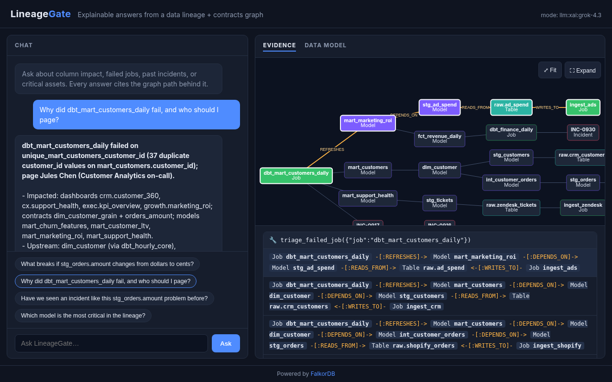

# LineageGate

**An explainable agent that answers "what breaks if this changes?" from a data lineage + contracts graph in [FalkorDB](https://www.falkordb.com/).**

Built for the WeMakeDevs **Graph Hacks: Context for AI Agents** hackathon, Track 01: Connected Data for AI Agents.

Data teams get asked the same questions over and over. What breaks if this column changes? Who owns this
dashboard? Why did this job fail, and have we seen it before? The answers live in *relationships*:
column → model → dashboard, asset → contract, asset → team → on-call person. LineageGate stores those
relationships in FalkorDB and gives an agent a few **Cypher-backed tools**. Every answer comes with the
**graph path** that justifies it. Without the graph, the agent has nothing to say.

> Inspired by common data-contract and lineage practices. Standalone demo on a fully synthetic
> dataset ("Acme Analytics"). No external services required.

## Example

```text
$ lineagegate ask --show-tools "What breaks if stg_orders.amount changes from dollars to cents?"
[mode: offline-router]
[tool] impact_from_column({"table": "stg_orders", "column": "amount"})
Changing `stg_orders.amount` (decimal(18,2), model stg_orders) reaches 13 downstream columns, 11 models and 5 dashboards.

Dashboards at risk: exec.kpi_overview, finance.cash_reconciliation, finance.revenue_daily, growth.marketing_roi, crm.customer_360
Contracts at risk: orders_amount v2.1 (amount is decimal(18,2) in USD dollars (not cents); not null; >= 0) ...
Owner teams to notify: Finance Analytics (10 assets); Customer Analytics (5 assets); Growth Analytics (2 assets)

Evidence (shortest graph path per dashboard):
  [6 hops] (Column stg_orders.amount) <-[:DEPENDS_ON]- (Column int_order_revenue.gross_revenue)
           <-[:DEPENDS_ON]- (Column fct_orders.order_amount) <-[:DEPENDS_ON]- (Column fct_revenue_daily.revenue)
           <-[:DEPENDS_ON]- (Column mart_finance_revenue.revenue_usd) <-[:HAS_COLUMN]- (Model mart_finance_revenue)
           <-[:DISPLAYS]- (Dashboard finance.revenue_daily)
  ...
```

## Quick start

Requirements: Docker, Python 3.11+.

```bash
git clone https://github.com/nightmoose/lineagegate && cd lineagegate
docker compose up -d                      # FalkorDB on :6379, Browser on http://localhost:3000
python3 -m venv .venv && .venv/bin/pip install -e '.[llm,dev]'
.venv/bin/lineagegate seed                # drop + load graph "acme" (111 nodes, 248 edges)
.venv/bin/lineagegate ask --show-tools "What breaks if stg_orders.amount changes?"
```

Other commands:

```bash
lineagegate impact stg_orders.amount            # pretty blast radius (add --json for raw output)
lineagegate owners stg_orders.amount            # owners (inherited from model), members, on-call
lineagegate path job:dbt_mart_customers_daily contract:customers_identity   # k shortest paths (algo.SPpaths)
lineagegate stats                               # counts by label / relationship type
pytest -q                                       # tool tests against a throwaway graph
```

### LLM mode

Tested with xAI Grok (`grok-4.3`, the default when `XAI_API_KEY` is set; override with `LLM_MODEL`).
`lineagegate ask` runs a small tool-calling loop when an OpenAI-compatible key is configured
(`XAI_API_KEY`, `OPENAI_API_KEY`, `ANTHROPIC_API_KEY`, or `LLM_BASE_URL` + `LLM_API_KEY`; see
`.env.example`). The model picks among the graph tools and is instructed to cite the returned paths.
With no key, a deterministic offline router chooses the tool from the question and renders a templated
answer, so the demo always runs end to end against FalkorDB. API errors also fall back to offline.

```text
$ lineagegate ask --show-tools "Last night a customer job failed. What happened, have we seen it before, and who should I page?"
[mode: llm:xai:grok-4.3]
[tool] triage_failed_job({})
Job dbt_mart_customers_daily failed on unique_mart_customers_customer_id (37 duplicate customer_id rows); matches INC-0917/INC-0916.
- Seen before: (Job dbt_mart_customers_daily) <-[:TRIGGERED_BY]- (Incident INC-0917) -[:RELATED_TO]-> (Incident INC-0916)
- Page: Jules Chen (Customer Analytics on-call).
```

### Web UI

`lineagegate serve` then open http://127.0.0.1:8000/ : chat on the left; on the right, the tools the agent
called, every graph path in the result (click one to highlight it), and a vis-network view of the paths.



### HTTP API

```bash
pip install -e '.[api]' && lineagegate serve      # http://127.0.0.1:8000/docs
curl localhost:8000/health
curl 'localhost:8000/impact?column=stg_orders.amount'
curl -XPOST localhost:8000/chat -H 'content-type: application/json' -d '{"question":"Why did dbt_mart_customers_daily fail?"}'
```

Also `/triage?job=`, `/incidents?node=&text=`, `/critical?algorithm=pagerank|betweenness`.

## Deploy (Fly.io)

Live demo: **https://lineagegate.fly.dev/**

One image (`Dockerfile`) runs FalkorDB on `127.0.0.1` plus the FastAPI app, so the database always
starts with the web app (no cross-app wake-up issues). `deploy/start.sh` seeds the `acme` graph on boot
if it is missing or empty, so a restart heals itself. No volume: graph state, including recorded
incidents, resets to the seed on restart.

```bash
fly apps create lineagegate
fly secrets set XAI_API_KEY=...        # optional; without it /chat uses the offline router
fly deploy --ha=false                  # fly.toml: iad, shared-cpu-1x 512MB, auto stop/start
```

## How it works

```
question ─► agent loop ─► tool (Cypher template) ─► FalkorDB graph "acme"
                │                                         │
                └──── answer + evidence paths ◄───────────┘
```

| Tool | What it does | Graph feature |
|---|---|---|
| `impact_from_column(table, column)` | Column-level downstream blast radius: models, dashboards, jobs, contracts, tests, owner teams, plus the shortest path to each impacted asset | variable-length `DEPENDS_ON*0..8` + fixed hops, path projection |
| `owners_for_node(node)` | Owning team/person (inherited through `HAS_COLUMN`), members, on-call | multi-hop `OWNED_BY` / `MEMBER_OF` |
| `paths_explain(source, target)` | k shortest connections between any two nodes, with edge directions | `algo.SPpaths` (fallback `shortestPath`) |
| `triage_failed_job(job?)` | Failed job → failing tests, upstream models + ingestion paths, contracts, dashboards at risk, on-call, similar past incidents | `REFRESHES`/`DEPENDS_ON*`/`READS_FROM`/`WRITES_TO` path patterns |
| `similar_incidents(node?, text?)` | Recall past incidents ranked by graph distance + keyword overlap, with the connecting path | `shortestPath` over lineage edges |
| `record_incident(...)` | Persist an incident linked to job/contracts and `RELATED_TO` similar ones: memory that survives across sessions | `MERGE` writes |
| `critical_assets(algorithm)` | Most structurally critical models with downstream reach + owner | `algo.pageRank`, `algo.betweenness` |

* Data model and scenarios: [`docs/data-model.md`](docs/data-model.md)
* Cypher used by each tool: [`docs/cypher.md`](docs/cypher.md)
* Demo script: [`docs/demo-script.md`](docs/demo-script.md)

## Repo layout

```
docker-compose.yml        FalkorDB (server + Browser) for local dev
Dockerfile, fly.toml      single-machine Fly deploy (FalkorDB + app); deploy/start.sh
data/                     synthetic seed as CSV (nodes_*.csv, edges_*.csv, incidents.json)
src/lineagegate/
  seed/generate.py        dataset spec -> data/*.csv  (lineagegate generate)
  seed/load.py            data/*.csv -> FalkorDB graph (lineagegate seed)
  graph/client.py         connection, node resolution, path rendering
  tools/lineage.py        impact / owners / paths tools + tool specs
  tools/ops.py            triage / incident memory / critical-asset tools
  api/static/index.html   single-file UI (vanilla JS + vis-network from CDN)
  api/app.py              FastAPI: /health /impact /chat /triage /incidents /critical
  agent/loop.py           LLM tool-calling loop + offline router
  cli.py                  command line
tests/                    tool tests against the seed
docs/                     data model, Cypher, demo script
```

## Status

- [x] Day 1: FalkorDB + seed + 3 tools + CLI impact answer with paths
- [x] Day 2: real LLM tool-calling (xAI Grok), failed-job triage, incident memory, critical assets, FastAPI
- [x] Web UI with chat + evidence panel (path list + graph view)
- [x] Hosted demo on Fly.io
- [ ] Video

## License

MIT. See [LICENSE](LICENSE). AI assistance is disclosed in [DISCLOSURE.md](DISCLOSURE.md).
