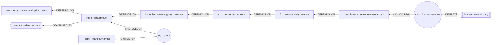

# Data model: synthetic "Acme Analytics"

A small but realistic analytics stack: SaaS sources → ingestion jobs → raw tables → dbt staging /
intermediate / mart models → BI dashboards, with data contracts, tests, owners, and past incidents.
Everything is fictional. Generated by `src/lineagegate/seed/generate.py` → `data/*.csv`.

**Seed size:** 111 nodes, 248 edges (graph `acme`).

## Node labels

| Label | Count | Key properties | Example id |
|---|---|---|---|
| Source | 5 | name, kind | `source:shopify` |
| Table | 6 | name, layer=raw, source | `table:raw.shopify_orders` |
| Column | 39 | name, table, fqn, data_type | `column:stg_orders.amount` |
| Model | 19 | name, layer (staging/intermediate/mart), materialized | `model:stg_orders` |
| Contract | 5 | name, version, spec, status | `contract:orders_amount` |
| Test | 6 | name, status (pass/fail), last_run_at | `test:unique_mart_customers_customer_id` |
| Job | 9 | name, kind (ingestion/dbt/bi_refresh), schedule, status, last_run_at, last_error | `job:dbt_mart_customers_daily` |
| Dashboard | 6 | name, title | `dashboard:finance.revenue_daily` |
| Person | 8 | name, email (@acme.example), slack, role, on_call | `person:priya.raman` |
| Team | 4 | name | `team:finance_analytics` |
| Incident | 4 | name, title, opened_at, severity, root_cause, resolution | `incident:INC-0917` |

Every node has a unique `id` (prefixed by kind) and a `name`. Each label has an index on `id`;
`Column` also has an index on `fqn`.

## Relationship types (direction = "depends on / points upstream")

| Type | Pattern | Meaning |
|---|---|---|
| HAS_COLUMN | (Table\|Model)→(Column) | structure |
| DEPENDS_ON | (Column)→(Column) | column-level lineage (downstream → upstream) |
| DEPENDS_ON | (Model)→(Model) | dbt `ref()` (downstream → upstream) |
| READS_FROM | (Model)→(Table), (Job)→(Source), (Test)→(Column\|Model) | reads / checks |
| WRITES_TO | (Job)→(Table) | ingestion output |
| REFRESHES | (Job)→(Model\|Dashboard) | orchestration |
| DISPLAYS | (Dashboard)→(Model) | BI consumption |
| GOVERNED_BY | (Column\|Model\|Test)→(Contract) | contract coverage / enforcement |
| OWNED_BY | (any asset\|Incident)→(Team\|Person) | ownership |
| MEMBER_OF | (Person)→(Team) | org |
| TRIGGERED_BY | (Incident)→(Job) | which job surfaced the incident |
| VIOLATED | (Incident)→(Contract) | which contract was broken |
| RELATED_TO | (Incident)→(Incident) | incident memory links |

Because all lineage edges point upstream, **impact = traverse incoming edges** from the changed node.

## Baked-in scenarios

1. **Column change impact.** `stg_orders.amount` (contract `orders_amount`: USD dollars, not cents)
   flows through `int_order_revenue` → `fct_orders` → `fct_revenue_daily` → `mart_finance_revenue`
   → dashboard `finance.revenue_daily` (plus cash reconciliation, exec KPIs, marketing ROI, customer 360).
   Owner: Finance Analytics. Past incident `INC-0802` was exactly this cents/dollars bug.
2. **Failed job triage.** `job:dbt_mart_customers_daily` is `failed` today (unique test on
   `mart_customers.customer_id`). Last month `INC-0916` (CRM duplicate ids, violated
   `customers_identity`) caused `INC-0917` (same job failure, violated `dim_customer_grain`).
3. **Hub table.** `dim_customer` is the most depended-on model (customer marts, `fct_orders`,
   marketing ROI) — candidate for PageRank / betweenness "critical asset" tooling.
